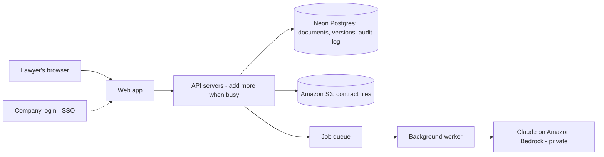
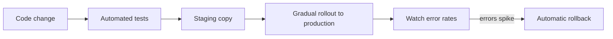

# From Prototype to Production

I'm approaching this from the customer's side: what an in-house legal team needs to trust and adopt this tool. I note where I'd lean on engineering for the details.

## Priorities

1. **Trust:** confidential contracts stay protected.
2. **Never lose work:** every document and change is safe and recoverable.
3. **Adoption:** lawyers actually use it day to day.

Scale comes last. Legal teams are small, so traffic isn't the main risk.

## How it fits together

**When a lawyer accepts a redline:**
1. They sign in with their company login.
2. The request goes to any available API server. The servers hold no data themselves, so we can add more when it's busy.
3. The API checks their permissions, then saves the new version in the database. If a colleague saved first, the change is rejected instead of overwriting theirs.
4. The change is recorded in the audit log.

**When a lawyer asks for AI suggestions:**
1. The request goes onto a queue, so the screen doesn't freeze.
2. A background worker asks Claude on Bedrock, inside our AWS account.
3. Suggestions that don't match the document are dropped, and the lawyer reviews the rest.

**How updates ship:**

## Security & compliance

What a General Counsel's security review will ask, and how we'd answer:

| They'll ask | Our answer |
|---|---|
| Who can log in? | Company login (SSO), so their IT team controls access |
| Who sees which contracts? | Roles (admin, lawyer, viewer) plus access per matter for sensitive work |
| Can you prove who did what? | An audit log of every view, edit, and export, which can't be altered |
| Is our data protected? | Encrypted while moving over the internet and while stored |
| Do you train on our data? | No. Customer data is never used for training. Claude runs through Amazon Bedrock, so contracts stay within our AWS account and aren't shared with the model provider |
| Any independent proof? | A SOC 2 Type II audit |
| What about EU data? | We delete data on request (GDPR) and offer EU hosting when needed |

**Later:** each customer's data in its own separate environment, for large enterprises that require it.

## Rolling this out to a new legal team

| Step | What happens | Done when |
|---|---|---|
| 1. Security review | Answer their questionnaire and share the audit report | Security signs off |
| 2. First use case | Start high-volume, low-risk work (e.g., NDAs) and load their playbook | Playbook reflects their real positions |
| 3. Pilot | 2–3 lawyers for 2–4 weeks; new features turned on just for them | Lawyers use it weekly without prompting |
| 4. Measure | Track the metrics below and share results with the GC | Clear time savings and accepted AI edits |
| 5. Expand | More contract types, more lawyers, and connections to the tools they already use | Use grows without added support load |

## Measuring success

**Customer value:**
- Time from upload to approved redline
- Share of AI suggestions accepted vs. rejected
- AI suggestions dropped for not matching the document (an early warning for made-up output)
- Weekly active lawyers and contracts per week

These numbers prove value to the GC and show where to expand next.

**Basic health:** the site is up and errors aren't spiking. Engineering gets alerted on real outages, not every blip.

## Reliability & operations

- The database is copied across multiple data centers and can be restored to any point in time. Contract files in S3 keep every version and are copied to a second region.
- If the AI is unavailable, editing and search still work.
- A status page, and a clear plan for who tells customers about an issue, and how quickly.

## The basics

| Area | Approach |
|---|---|
| Architecture | Hosted on AWS. A Postgres database on Neon replaces the in-memory store, Amazon S3 holds the contract files, and Claude runs privately through Amazon Bedrock. |
| Releases | Tests run automatically on every change. Updates roll out gradually so a bug doesn't hit everyone at once. |
| Scale | Add servers automatically when the app gets busy. |
| Cost | AI is likely the biggest cost, so each customer has usage limits and spending alerts. |

## Key trade-offs

| Choice | What we gain | What we give up |
|---|---|---|
| Neon for the database | Fast to set up, scales down when quiet, pay only for what we use | One more vendor for customers' security teams to review. We could move to AWS's own database if a customer wants a single vendor |
| Claude through Amazon Bedrock | Contracts stay within our AWS account, with one vendor contract to manage | The newest models sometimes arrive on Bedrock a bit later than through Anthropic directly |
| One shared environment for all customers | Cheaper and simpler to run | Less separation than giving each large customer its own environment, which is why that's planned for later |

**First change from the prototype:** the in-memory store and the version check move into the database, so several servers can share the same data safely.

## Where I'd partner with engineering

- Picking the exact cloud services and server sizes
- Scaling for very large documents and volumes
- Hosting in multiple regions

## Biggest risks

- **AI that's correct but wrong for the business:** handled by human approval on every change and suggestions based on the customer's own playbook.
- **A security incident:** handled by the controls above, plus regular outside testing.
- **Low adoption:** handled by a focused pilot before expanding.
