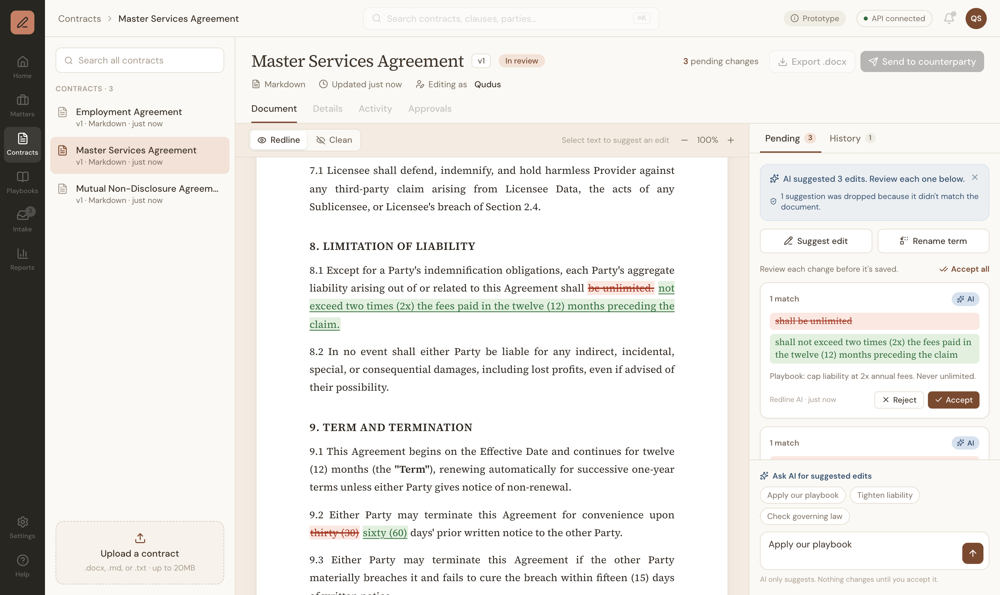

# Redline Review

**A redlining and search service for in-house legal teams: propose, preview, and approve contract edits, with AI suggestions you can trust.**



Every edit, whether from a person or the AI, becomes a **pending redline** you can see inline (red strikethrough, green underline) before anything is saved. You accept or reject each one, and every accepted change lands in a version history that records who changed what, when, why, and whether it came from the AI.

---

## Contents

1. [Who it's for](#who-its-for)
2. [Quick start](#quick-start)
3. [Demo walkthrough](#demo-walkthrough)
4. [API reference](#api-reference)
5. [Product decisions](#product-decisions)
6. [Deploying this with a legal team](#deploying-this-with-a-legal-team)
7. [API design rationale](#api-design-rationale)
8. [Architecture](#architecture)
9. [Performance](#performance)
10. [Testing](#testing)
11. [Limitations](#limitations)
12. [What I'd build next](#what-id-build-next)
13. [How I built this](#how-i-built-this)

---


## Who it's for

**Sarah, Commercial Counsel** at a 300-person SaaS company. She handles ~40 NDAs and MSAs a month, often on deadline from sales. She's skeptical of AI that "makes things up," and she needs to show her General Counsel what changed and why.

As Sarah, I can:

1. **Upload a contract** (.docx, .md, or .txt) and read it with its structure intact.
2. **Search across all contracts** for a clause ("limitation of liability") and jump to each hit.
3. **Select text and propose an edit**, see the redline inline before it's saved, and accept or reject it.
4. **Rename a defined term everywhere** in one action, and see the count before it applies.
5. **Ask the AI for suggested edits** based on our playbook, and review each one before anything changes.
6. **See the full history** of who changed what, when, and why, including which changes came from the AI.

---


## Quick start

**Prerequisites:** Python 3.11+ and Node 20+.

```bash
npm run setup     # creates backend/.venv, installs Python and Node dependencies
npm run dev       # starts the API (port 8000) and the web app (port 3000) together
```

- App: [http://localhost:3000](http://localhost:3000)
- Interactive API docs: [http://localhost:8000/docs](http://localhost:8000/docs)
- Tests: `npm test`

**AI suggestions (optional).** Everything except "Ask AI" works without a key. To turn it on:

```bash
cp backend/.env.example backend/.env
# then set ANTHROPIC_API_KEY in backend/.env (the server reloads automatically)
```

Without a key, the Ask AI box shows a friendly "AI isn't set up yet" message (HTTP 503), not an error page.

> Documents live in memory for the session. Restarting the API resets the three sample contracts.

---


## Demo walkthrough

The sample contracts are fictional and have scenarios planted in them. Open the **Master Services Agreement**:

1. **Search.** Type `liability` in the left search box and click the "Limitation of Liability" result. The contract opens, scrolls to the clause, and highlights it.
2. **Fix an ambiguous edit.** Select `thirty (30) days` in §9.2 and click **Suggest edit**. Enter `sixty (60) days` and click **Add change**. The phrase also appears in §4.1 (payment terms), so instead of guessing, the app asks **"Which one did you mean?"** and shows both in context. Pick the termination clause, and the redline appears inline.
3. **Rename a defined term.** Click **Rename term**: `Licensee` → `Customer`. It shows **"Will change 24 occurrences"** before adding anything. Whole-word matching means "Sublicensee" is untouched. (Try renaming `Term` with "Whole words only" unchecked: it would also hit "**Term**ination".)
4. **Ask the AI** (needs a key). Send "Apply our playbook." Suggestions arrive as cards with an **AI** badge and a reason that cites the playbook (unlimited liability → 2x fees cap, California → Delaware law, 30 → 60 days' notice). Any suggestion whose text isn't actually in the contract is dropped, and the panel says so.
5. **Accept** changes one by one or with **Accept all**, then open **History**: each version shows the author, the reason, and "AI suggestion, accepted by …" where relevant.
6. **Upload** `samples/sample-vendor-agreement.docx` by dragging it onto the upload box. Headings and bold text survive the conversion.

Grayed-out controls (other nav items, Export, Send, extra tabs) are placeholders that show where this screen would sit in a full product. Hover any of them for a note.

---


## API reference

Runnable examples for every endpoint: [samples/requests.sh](samples/requests.sh) (start the API, then `bash samples/requests.sh`). The full schema is at `/docs`.


| Method | Path                                              | Purpose                                                                                |
| ------ | ------------------------------------------------- | -------------------------------------------------------------------------------------- |
| GET    | `/health`                                         | Health check                                                                           |
| GET    | `/documents`                                      | List documents (no text): `id, title, file_type, version, updated_at, size_chars`      |
| GET    | `/documents/{id}`                                 | One document with its text and current `version`                                       |
| POST   | `/documents`                                      | Create from JSON `{title, text}`                                                       |
| POST   | `/documents/upload`                               | Upload .docx / .md / .txt (multipart), converted to Markdown                           |
| PATCH  | `/documents/{id}`                                 | Apply one or more changes (all-or-nothing) and save a new version                      |
| POST   | `/documents/{id}/preview`                         | Same body as PATCH, **saves nothing**; returns the would-be text and an inline redline |
| POST   | `/documents/{id}/suggestions`                     | AI-suggested changes (validated against the document), **saves nothing**               |
| GET    | `/documents/search?q=&limit=&offset=&whole_word=` | Search all documents (case-insensitive, paged)                                         |
| GET    | `/documents/{id}/search?q=…`                      | Search one document                                                                    |
| GET    | `/documents/{id}/history`                         | Versions, newest first: author, timestamp, and each change's reason and source         |


### Example: edit a document

```http
PATCH /documents/master-services-agreement
{
  "expected_version": 1,
  "author": "Sarah",
  "changes": [
    {
      "operation": "replace",
      "target": { "text": "thirty (30) days", "occurrence": 2 },
      "replacement": "sixty (60) days",
      "reason": "Playbook: 60 days' notice for termination"
    },
    {
      "operation": "replace",
      "target": { "text": "Licensee", "occurrence": "all" },
      "replacement": "Customer"
    }
  ]
}
```

```json
{
  "id": "master-services-agreement",
  "version": 2,
  "text": "# Master Services Agreement\n\n…updated text…",
  "applied": [
    {
      "find": "thirty (30) days",
      "replace": "sixty (60) days",
      "occurrence": 2,
      "count": 1,
      "reason": "Playbook: …",
      "source": "human"
    },
    {
      "find": "Licensee",
      "replace": "Customer",
      "occurrence": "all",
      "count": 24,
      "reason": null,
      "source": "human"
    }
  ]
}
```

`target` fields: `text` (exact, case-sensitive), `occurrence` (`1`, `2`, … or `"all"`; omit it when the text appears once), and `whole_word` (default `true`). Other change fields: `replacement` (`""` deletes the text), `reason`, and `source` (`"human"` or `"ai"`).

### Errors

Every error has the same shape, with a message written for a lawyer, not a developer:

```json
{
  "error": "\"thirty (30) days\" appears 2 times. Choose which one to change, or choose all.",
  "code": 422,
  "type": "ambiguous_match",
  "details": {
    "change_index": 0,
    "count": 2,
    "matches": [
      { "occurrence": 1, "snippet": "…", "match_start": 61, "match_end": 77 }
    ]
  }
}
```


| Status | `type`                                                           | When                                                                                        |
| ------ | ---------------------------------------------------------------- | ------------------------------------------------------------------------------------------- |
| 400    | `invalid_request`                                                | Malformed payload (FastAPI's validation errors are reshaped into this format), empty search |
| 404    | `not_found`                                                      | Unknown document or endpoint                                                                |
| 409    | `version_conflict`                                               | `expected_version` is stale; `details.current_version` says what's current                  |
| 413    | `too_large`                                                      | Upload over 20MB, or document too large for AI                                              |
| 415    | `unsupported_file_type`                                          | Anything but .docx / .md / .txt                                                             |
| 422    | `target_not_found`, `ambiguous_match`, `occurrence_out_of_range` | The change can't be applied as written                                                      |
| 500    | `server_error`                                                   | Unexpected; the real error is logged, never shown                                           |
| 502    | `ai_unavailable`                                                 | The AI provider failed or declined                                                          |
| 503    | `ai_not_configured`                                              | No API key set                                                                              |


---


## Product decisions

These matter more than the code. Each one trades something away on purpose.

- **Edits target text, not character positions.** "Find `State of California`, replace with `State of Delaware`" is how lawyers and LLMs describe edits. Positions go stale after any earlier edit, and a wrong position silently corrupts the contract. With text targeting, missing text fails loudly. *(Ranges could be added later for precise tools.)*
- **Ambiguous edits are rejected, and the user is helped to pick.** If the text appears more than once and no `occurrence` is given, the API returns the count and a snippet of each match, and the UI turns that into a "Which one did you mean?" picker. Silently editing the first match is fast, but editing the wrong clause is the worst failure in a contract.
- `occurrence: "all"` **for renaming defined terms**, with the count shown before anything is added. Renaming "Licensee" to "Customer" across a contract is one of the most common legal edits.
- **Whole-word matching by default**, so renaming "Term" doesn't touch "Termination". It uses lookarounds, not `\b`, so phrases that start or end with punctuation, like `(a)`, still match.
- **Edits are case-sensitive; search is not.** "Company" (a defined term) and "company" (the generic word) mean different things in a contract, but people type search queries loosely.
- **Several changes per request, all-or-nothing.** A half-applied redline is worse than none. Changes apply in order to a copy, and nothing is saved unless every one succeeds; the error says which change failed.
- **Version numbers catch conflicting edits.** Writes send the `expected_version` they were looking at; if someone saved since, the API returns **409** instead of overwriting their work, and the UI offers a one-click reload that keeps your pending changes.
- **Preview before saving.** `POST /preview` runs the same changes without saving and returns the inline redline. This powers the accept/reject screen, and it means problems (ambiguous or missing text) show up while you're reviewing, not after you click Accept.
- **Every change records** `author`**,** `reason`**, and** `source` (`human` or `ai`), so the audit trail distinguishes "AI suggestion, accepted by Sarah" from Sarah's own edits.
- **Full-text snapshot per version.** Simple, and it makes restoring an old version trivial: a restore would create a *new* version, so nothing is ever erased. Production would store diffs to save memory.
- **AI suggests, never applies.** AI output arrives in the same shape as human edits and goes through the same review. Before anyone sees it, a **deterministic guardrail** applies each suggestion to the real text and **drops any whose text isn't there (hallucinated) or is ambiguous**, and the UI says how many were dropped and why. The AI can be wrong; it can't put words in the contract that aren't there or edit the wrong clause.
- **The AI follows a house playbook** ([backend/data/playbook.md](backend/data/playbook.md)): 2x fee liability cap, Delaware law, Net 30, 60 days' termination notice, 3-year NDA term, mutual indemnities. Suggestions stay consistent with company standards no matter who's reviewing.
- **Uploads become Markdown.** Markdown keeps headings, bold, and numbering while staying plain text underneath, so the same edit and search logic works for every file type. **No PDF in v1:** contracts are negotiated in Word, and PDFs are usually the signed final copy.

---


## Deploying this with a legal team

If I were rolling this out with an in-house legal team, I'd start narrow, prove value on one high-volume workflow, then expand.

**First use cases**

1. **NDA triage.** High volume, low risk, and the playbook positions are clear (for example, a three-year confidentiality term). This is where AI suggestions save the most time with the least downside.
2. **Vendor and customer MSAs against the playbook.** Liability caps, governing law, termination notice, and payment terms are the clauses lawyers fix over and over.
3. **Defined-term cleanup** when a template changes, such as renaming "Licensee" to "Customer" across a contract.

**Pilot plan (about six weeks)**

- **Before week 1:** work with the General Counsel to write down the team's playbook positions, and gather 10 to 20 recent contracts as a baseline.
- **Weeks 1–2:** two or three commercial counsel use it on NDAs only. Every AI suggestion is reviewed, and I hold a short weekly check-in to hear what's missing or wrong.
- **Weeks 3–6:** expand to MSAs, and update the playbook based on what lawyers keep rejecting.
- **End of pilot:** review the metrics with the GC and decide whether to roll out to the wider team, and which workflow comes next.

**How I'd measure success**

- **Turnaround time** per contract, compared with the baseline.
- **AI suggestion accept rate.** A low rate tells me the playbook or prompt needs work.
- **Guardrail drop rate:** how often the AI quotes text that isn't in the contract. It should stay low; a rise is an early warning.
- **Escalations to the GC** that the playbook should have handled.
- **Weekly active reviewers**, to see whether the tool sticks after the first few weeks.

The biggest risk I'd watch is the Word workflow. Lawyers negotiate in Word, so export with tracked changes (#1 in [What I'd build next](#what-id-build-next)) is likely what decides adoption beyond the pilot.

---

## API design rationale

- **REST resources plus a few action endpoints.** Documents are resources: `GET` to read, `POST` to create, `PATCH` to edit. "Run these edits but don't save" (`/preview`) and "ask the AI" (`/suggestions`) aren't updates to a resource, so they're explicit `POST` actions rather than overloaded flags on `PATCH`.
- **Reads and writes are separate.** `GET` never changes anything. Preview and suggestions are `POST` because they take a body, but they also save nothing.
- `expected_version` **in the body, not an** `If-Match` **header.** ETags with `If-Match` are the more "correct" HTTP mechanism, but a body field is easier for clients to send, visible in the `/docs` page, and easier to explain to an integration partner. The semantics are the same (optimistic concurrency, 409 on mismatch), so switching later is easy.
- **Text targeting, not ranges** (see above). The `operation` field (`"replace"` only, for now) mirrors the brief's example shape and leaves room for new operations without breaking clients. A deletion is a replace with `""`.
- **Validation errors are 400, not FastAPI's default 422.** 422 is reserved for "your request was well-formed, but the text isn't in the contract," which is a different problem for a client to handle.

---


## Architecture

```
redline-review/
├── package.json             # npm run setup / dev / test (runs both servers with concurrently)
├── samples/requests.sh      # curl examples for every endpoint
├── docs/infra-notes.md      # notes for productionizing (Part II)
├── backend/                 # Python + FastAPI: all business logic
│   ├── app/
│   │   ├── main.py          # routes + error handlers only (thin)
│   │   ├── models.py        # request/response shapes (Pydantic)
│   │   ├── redline.py       # edit logic: apply changes, build the redline
│   │   ├── search.py        # search with snippets and paging
│   │   ├── matching.py      # find_matches / make_snippet, shared by both
│   │   ├── store.py         # in-memory documents, lock, versions
│   │   ├── parsing.py       # upload → Markdown
│   │   ├── llm.py           # AI suggestions + guardrail
│   │   └── errors.py        # error types (status, type, message, details)
│   ├── data/                # sample contracts + playbook.md
│   └── tests/
└── frontend/                # Next.js + TypeScript + Tailwind: display only
    ├── app/page.tsx         # the screen; owns state, calls the API
    ├── components/          # sidebar, viewer, changes panel, edit form, …
    └── lib/api.ts           # typed fetch helpers mirroring models.py
```

- **Logic is separate from routes.** `redline.py`, `search.py`, and `matching.py` are pure functions with no web framework, so they're easy to test and reuse. Each route in `main.py` reads the request, calls one function, and returns the result.
- **The frontend only displays data.** Every rule (matching, ambiguity, versioning, the AI guardrail, the redline diff) lives in Python, where it's tested in one place. The redline itself is built on the server by comparing before/after text word by word (`difflib`), and comes back as Markdown with `<del>`/`<ins>` tags.
- **One command runs everything.** Next.js forwards `/api/` to FastAPI, so there's no cross-origin setup.
- **In-memory storage, isolated in `store.py`.** No database to install, instant lookups, and a single lock wraps "check version → apply → save" so two simultaneous edits can't both start from the same text. Swapping in Postgres means changing one module. The trade-off: data lasts only as long as the server, and the lock only works on one server (see [docs/infra-notes.md](docs/infra-notes.md)).
- **AI call design.** One small function calls Claude (`claude-sonnet-5-5` by default, set in `.env`). **Structured outputs** guarantee the reply matches our JSON schema (`[{find, replace, reason}]`), so there's no free-text parsing. If the model declines or the call fails, the user gets a plain message instead of an error page. The function is swapped for a fake in tests, so the tests need no key or network. In production, documents sent to a model provider would go under a zero-data-retention agreement.

---


## Performance

Measured by [backend/tests/test_performance.py](backend/tests/test_performance.py) on a generated **10MB** contract (Apple M1 Pro). Run it yourself: `cd backend && .venv/bin/pytest tests/test_performance.py -s`.


| Operation on 10MB                                                   | Time             |
| ------------------------------------------------------------------- | ---------------- |
| Find all 104,733 matches of "Customer" (whole word)                 | 147 ms           |
| Find a unique phrase near the end                                   | 144 ms           |
| Replace one unique phrase                                           | 149 ms           |
| Rename "Customer" everywhere (104,733 replacements)                 | 161 ms           |
| Search "customer data", first page of 34,911 hits                   | 66 ms            |
| Search, last page (line numbers counted deep in the file)           | 140 ms           |
| Full API round trip: upload 10MB / PATCH rename everywhere / search | 82 / 171 / 66 ms |


**Why it's fast:** matching is a single regex pass over the text (linear time). Replacements are built from slices in one pass and joined once, never by repeated string concatenation. Search collects only match *positions* first (so `total` is exact and cheap), then builds snippets and line numbers only for the requested page.

**Deliberate limits for large documents:**

- **The inline redline is skipped above 300k characters.** A word-by-word diff gets slow on huge texts, so the API returns `redline_markdown: null` and the UI shows each change as a card instead.
- **AI review is capped at 150k characters.** Chunking long contracts into sections is the next step.
- **Version snapshots cost memory.** Each version stores the full text, so ten edits to a 10MB contract hold ~100MB. Production would store diffs.


### Search indexing: why not an inverted index (yet)

An **inverted index** is like the index at the back of a book: a map from each word to every place it appears. A search then looks up words instead of scanning the whole text.

- **When it's worth it:** many repeated searches over a large corpus that rarely changes, such as searching across thousands of executed contracts.
- **What it costs:** memory (often a large fraction of the text size); an update on **every edit**, which in a redlining tool is constant; and weak phrase support (phrases like `thirty (30) days` need positional indexes and a check against the original text).

Here, a linear scan handles 10MB in about 0.1 seconds and is always consistent with the latest edit, so the index isn't worth its complexity yet. At scale I'd move to Postgres full-text search or OpenSearch, re-indexed from a queue after each save.

---


## Testing

```bash
npm test                                                   # all 95 backend tests
cd backend && .venv/bin/pytest tests/test_performance.py -s  # with printed timings
```


| File                  | Covers                                                                                                                                                                                                                                                                    |
| --------------------- | ------------------------------------------------------------------------------------------------------------------------------------------------------------------------------------------------------------------------------------------------------------------------- |
| `test_redline.py`     | Single, nth, and "all" replacements; ambiguity with counts and snippets; not found; out of range; whole-word; case sensitivity; deletion; backslashes inserted literally; all-or-nothing bulk; redline output (grouping, bold markers, no newlines inside tags, size cap) |
| `test_search.py`      | Case-insensitivity, snippet offsets, line numbers, paging with an exact total, one-document filter, no results, empty query                                                                                                                                               |
| `test_store.py`       | Seeding, versions with attribution, 409 conflicts, failed bulk edits save nothing                                                                                                                                                                                         |
| `test_api.py`         | Every endpoint through HTTP, including 400/404/409/415/422/500 error shapes, preview not saving, uploads (.txt and the sample .docx)                                                                                                                                      |
| `test_parsing.py`     | .txt/.md/.docx conversion, line endings, damaged .docx, PDF rejected, size limit                                                                                                                                                                                          |
| `test_llm.py`         | The guardrail (hallucinated and ambiguous suggestions dropped, in-order checking), the endpoint saving nothing, AI changes applied and attributed in history, friendly 503 without a key. The AI call is always faked.                                                    |
| `test_performance.py` | The 10MB benchmarks above                                                                                                                                                                                                                                                 |


---


## Limitations

- **Formatting is partly lost on .docx import.** Headings, bold, and paragraphs survive; tables, comments, and existing tracked changes don't.
- **Edits can't span formatting.** Selecting text that crosses a **bold** boundary won't match, because the stored Markdown contains `**` markers that aren't on screen.
- **In-memory only.** Restarting the API resets everything.
- **No PDF import.**
- **Uploads through the app are limited to about 10MB.** The Next.js dev proxy rejects larger files; the API itself accepts up to 20MB when called directly (for example with `curl`).
- **Very large documents display slowly.** The API handles a 10MB contract in under 0.2 seconds, but formatting that much text in the browser takes a long time (about 50 seconds for 15MB). Real contracts are usually well under 1MB.
- **AI review is limited to 150k characters**, and it's untested against the live API in this repo's tests (the call is faked).
- **No auth or permissions.** "Editing as" is a free-text name.

---


## What I'd build next

Ranked by customer impact:

1. **Export to Word with tracked changes**, keeping the original formatting, so redlines go back to the counterparty in the format they expect.
2. **Playbook review that flags deviations**, not just suggests edits: a checklist of "this contract vs. our positions."
3. **Version compare view and restore.**
4. **Comments and threads** on individual changes.
5. **Auth:** SSO and role-based permissions per matter.
6. **Persistence:** Postgres for documents, versions, and the audit log; object storage for large bodies; diffs instead of snapshots.
7. **Search at scale:** an inverted index or a search engine.
8. **Chunked AI review** for long contracts.
9. **PDF import.**
10. **Deployment.**

---

## How I built this

**I started with the customer, not the code.** After reading the brief, I researched how in-house legal teams work and what they need before they'll trust AI-assisted redlining: output they can verify against the contract, human approval on every change, and an audit trail. That shaped every product decision above.

**What's mine: the product and design decisions.** I used Claude as a collaborator throughout: I asked for options and trade-offs on each key decision, pushed back where I disagreed, and chose the path I thought was best for the customer. For example:

- I rejected a plain-text document view as not product-minded, in favor of a formatted "paper" view with inline, track-changes-style redlines and an accept/reject panel.
- I chose to reject ambiguous edits and help the user pick, rather than silently change the first match.
- I required "change all" for renaming defined terms, with whole-word matching.
- I kept the AI as a suggester only, with a check that drops any suggestion quoting text that isn't in the contract.
- I scoped uploads to .docx, .md, and .txt, because PDFs are usually signed final copies, not drafts under negotiation.
- I kept storage in memory for the session, isolated in one module so it can be swapped for a database.
- I moved editing from a pop-up into the side panel, so a lawyer can see the whole contract while typing an edit.

I turned those decisions into a written plan: a decision log with reasons, an API spec, a phased build, and must/should/nice scope tiers to fit the time limit.

**What I directed and verified, but didn't write line by line: the implementation.** Claude Code wrote most of the code from that plan, including the Python and TypeScript, the word-by-word comparison that builds the redline, the React state handling, and the details of the AI call. I'm comfortable reading Python and TypeScript, but I haven't shipped a production app like this before. I can explain what each part does, why it's there, and how the pieces connect. For some lower-level pieces, like the comparison that builds the redline, I'd lean on documentation or AI to rewrite them from scratch.

**How I checked the work.** I set the rules up front (the simplest readable code, logic kept separate from routes, docstrings with worked examples), reviewed each phase before moving on, and tried the demo flows myself. Testing surfaced real issues that we then fixed, like a redline that split a paragraph in two and bold formatting that broke around renamed terms. Where something wasn't worth its complexity, I cut it and listed it under [Limitations](#limitations).

AI did most of the typing. The customer thinking, the decisions, and the judgment about what to build, cut, and verify are mine.
